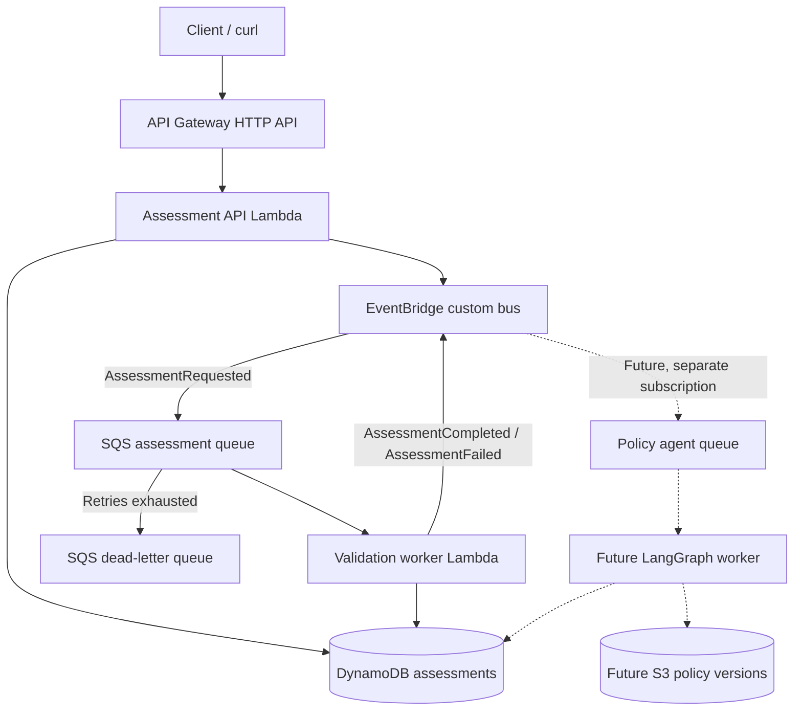

# AWS Event-Driven Policy & Validation Platform

## Purpose and scope

This document describes the non-AI MVP for asynchronous assessment submission and deterministic validation. The first release demonstrates AWS CDK, event-driven processing, operational recovery, and controlled CI/CD. It uses synthetic data only. Frontend, authentication, real legal/compliance validation, multi-region deployment, and generative AI are out of scope. The policy-agent architecture is a future extension and must not alter the deterministic assessment path.

## System context

The client submits and later retrieves an assessment through the HTTP API. The API handler validates and persists a `PENDING` assessment before publishing `AssessmentRequested`. EventBridge routes only the request event to the assessment queue. The worker consumes queued work, applies pure deterministic rules, persists the terminal result, and publishes a completion or failure event. SQS isolates the producer from worker availability and provides retry and DLQ behavior.

Each independent subscriber owns a separate queue. Completion events must not match the assessment-request rule. The future policy workflow receives its own event patterns, queue, worker, and storage; it cannot change active deterministic rules without an explicit lifecycle and activation policy.

## Components and ownership

| Component | Responsibility | Owns |
|---|---|---|
| API Gateway HTTP API | Expose `POST /assessments` and `GET /assessments/{id}` | Request boundary and payload-size limits |
| Assessment API Lambda | Validate client input, create or retrieve an assessment, publish the request event | API behavior and publish-gap recovery metadata |
| DynamoDB | Persist assessment lifecycle, result, publish status, and timestamps | Durable assessment state |
| EventBridge custom bus | Route versioned domain events to explicit subscribers | Event routing, not work buffering |
| Assessment SQS queue | Buffer request events and deliver at least once | Consumer backlog and retry policy |
| Validation worker Lambda | Claim work, run deterministic rules, persist result, publish terminal event | Processing transition and terminal outcome |
| SQS DLQ | Retain messages that exhaust configured receives | Operator inspection and controlled redrive |
| CloudWatch | Collect logs, metrics, and alarms | Operational visibility |
| CDK application | Define environment-scoped infrastructure, IAM, outputs, and tags | Deploy, update, and destroy lifecycle |

Suggested code boundaries are `apps/assessment-api`, `apps/validation-worker`, `packages/event-contracts`, `packages/rule-engine`, `packages/shared`, and `infrastructure/cdk`. AWS SDK adapters stay outside the pure rule engine. The future `apps/policy-agent` is not part of MVP implementation.

## Assessment lifecycle and API behavior

Assessment states are `PENDING` → `PROCESSING` → `COMPLETED` or `FAILED`. `publishStatus` separately tracks request-event publication (`PENDING` or `PUBLISHED`); store timestamps, attempt count, and a safe failure reason as appropriate. A terminal business validation failure is an assessment outcome, not automatically an infrastructure incident.

- `POST /assessments` validates the request, persists it, and returns `202 Accepted` with an assessment ID and current status. Repeated submission behavior must be explicitly defined and tested; it must not create unintended duplicate effects.
- `GET /assessments/{id}` returns the persisted status and result when available. It must not expose internal stack details or sensitive data.
- Requests and logs use synthetic company details only. Example identifiers in fixtures are placeholders, not real or valid identifiers.

## Event contracts

The v1 domain events are `AssessmentRequested`, `AssessmentCompleted`, and `AssessmentFailed`. Contracts are versioned JSON schemas with runtime validation and contract tests. Each event carries `eventId`, `eventVersion`, `correlationId`, `occurredAt`, `assessmentId`, and event-specific identifiers or result data. Consumers tolerate unknown optional fields and explicitly reject unsupported major versions.

EventBridge rules use explicit `source` and `detail-type` patterns. The request queue rule matches only `AssessmentRequested`; terminal event publication cannot feed work back into that queue. Event payloads and structured logs must exclude real personal information and unnecessary sensitive request fields.

## Reliability and failure behavior

| Failure point | Required behavior |
|---|---|
| Invalid API request | Reject before persistence or publication with a safe client error. |
| Request event publication fails after persistence | Leave the assessment discoverable as unpublished/pending; reconciliation republishes it. This boundary is non-atomic. |
| Duplicate or concurrent SQS delivery | Conditional state transitions and idempotent result persistence prevent inconsistent outcomes. |
| Retryable infrastructure failure | Fail the invocation so SQS retries according to the queue policy; acknowledge only after successful processing. |
| Non-retryable business validation failure | Persist the terminal failure and publish `AssessmentFailed`; do not treat it as an endless infrastructure retry. |
| Request message exhausts receives | Move it to the DLQ; inspect and redrive only after understanding or fixing the cause. |
| Terminal event publication fails after result persistence | Persist enough unpublished terminal-event state for reconciliation and eventual publication. |

The SQS visibility timeout must exceed the worker timeout. Configure a bounded receive count, DLQ retention, and worker concurrency appropriate for a demo. If a batch size greater than one is selected, report per-record failures so successful records are not retried unnecessarily. Redrive must preserve idempotency.

The initial request-publish and terminal-event-publish gaps are addressed with explicit reconciliation. A transactional outbox is a possible later improvement, not an MVP assumption. For a demo, a scheduled reconciler may use a status/index query; bounded scans are acceptable only when their limitations are documented. Reconciliation must be safe under repeated and concurrent runs.

## Data and infrastructure

Use a DynamoDB table with on-demand capacity for the isolated development stack. Model keys and indexes around assessment lookup and reconciliation queries, not broad table scans. TTL may be used for disposable test data only when its retention and data-loss implications are documented. Do not rely on TTL for timely operational recovery.

The CDK stack should use a unique development prefix, resource tags, explicit outputs, and a documented destroy command. Avoid VPC/NAT and always-on resources unless a concrete requirement emerges. Scope IAM permissions to the specific table, bus, and queues. Keep credentials outside the repository and use GitHub OIDC for optional controlled deployment; never add static AWS keys.

CloudWatch visibility should include structured logs with correlation IDs and alarms for DLQ messages, queue age, API errors, and worker errors. Tracing is optional. Before deploying, configure an AWS budget alert and understand resource costs and cleanup steps. No deployment or paid cloud action is implied by these documents.

## Testing and delivery

- Unit tests cover pure rule behavior, schema validation, lifecycle transitions, and duplicate handling.
- CDK assertions cover queue/DLQ wiring, event filters, timeout relationships, IAM scope, and alarms.
- Integration tests verify producer/consumer contracts and AWS adapters, using local mocks where feasible.
- Deployed end-to-end verification covers POST → event → queue → worker → GET terminal status.
- Failure demonstrations cover duplicate delivery, transient worker failure, poison messages/DLQ redrive, request publication failure, and terminal-event publication failure.
- CI runs typecheck, lint, unit tests, CDK synth/assertions, and security checks. Dev deployment is separately controlled and uses OIDC if enabled.

See [tickets/README.md](tickets/README.md) for the MVP implementation order and ticket status. Each ticket must meet the project definition of done in `plan.md`; no later ticket starts automatically.

## Assumptions and open design questions

- MVP accepts one isolated development environment and synthetic data; production retention, privacy, and recovery requirements are not defined.
- Assessment ID generation and the exact duplicate-submission key/response semantics must be decided in T05 before implementation.
- DynamoDB access patterns and indexes for reconciliation must be finalized alongside the reconciler design in T07 and T12.
- The plan does not set API rate limits, payload limits, concurrency targets, or numeric retry/retention values. Choose conservative demo defaults and record them in CDK and the runbook.
- The boundary between terminal business failures and supported terminal processing failures needs a typed error taxonomy before T12.
- Budget alert amount and deployment region are user/environment-specific and must be configured before deployment.
- Whether future AI-generated candidates can ever auto-activate is intentionally unresolved; T16 requires an explicit decision and must not silently activate rules.

## Decision records

- [ADR 0001: EventBridge and SQS](decisions/0001-eventbridge-and-sqs.md)
- [ADR 0002: DynamoDB assessment persistence](decisions/0002-dynamodb-assessment-store.md)
- [ADR 0003: At-least-once delivery and idempotency](decisions/0003-idempotent-processing.md)
- [ADR 0004: Recovery for event publication gaps](decisions/0004-publish-gap-recovery.md)