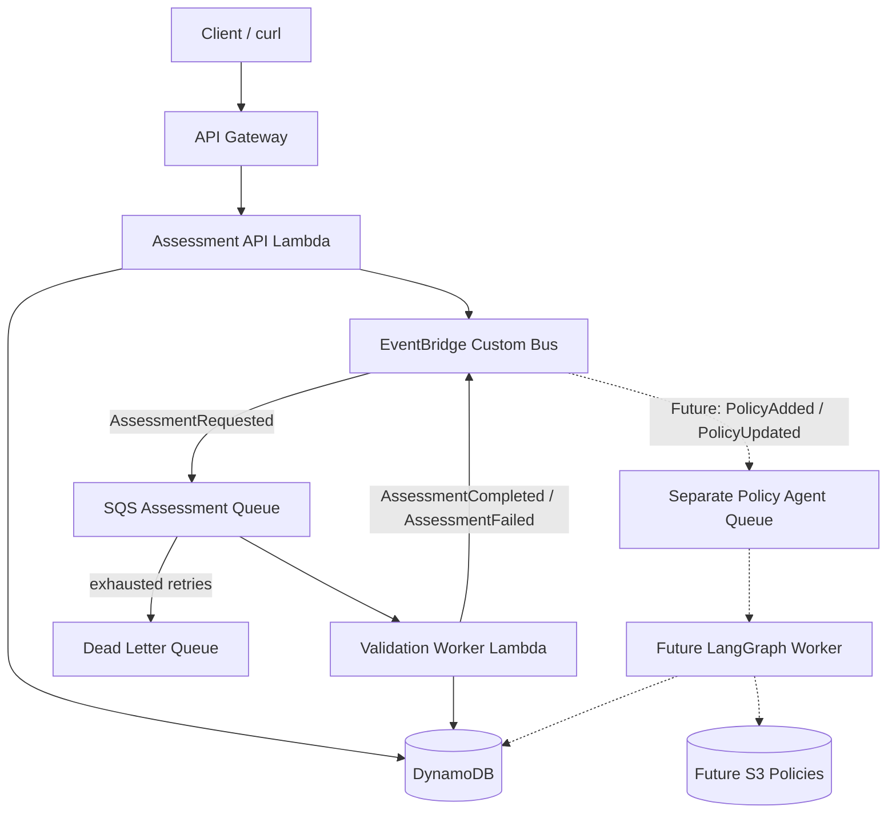
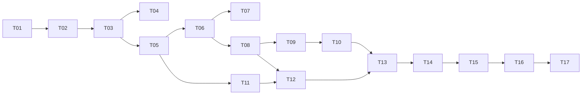

# AWS Event-Driven Policy & Validation Platform — Implementation Plan

**Status:** Planning  
**Primary goal:** Demonstrate AWS CDK, event-driven architecture, production-oriented engineering, and CI/CD.  
**Future goal:** Add an independent agentic AI policy-processing workflow without disrupting deterministic assessment processing.  
**Language:** TypeScript (Node.js LTS), AWS CDK v2.  
**Delivery model:** Small, independently testable tickets. Do not implement the full project in one pass.

## 1. Objectives

Build a portfolio-quality AWS application in which a client submits company information for asynchronous validation. The application persists an assessment, emits a domain event, routes it through EventBridge and SQS, executes deterministic rules in Lambda, and stores a result. Follow-on subscribers can respond to completion events. The first release excludes AI.

The demo must visibly demonstrate:
- Infrastructure as code with CDK, including deploy, update and destroy.
- EventBridge routing and decoupled SQS consumers.
- Durable processing, retries, DLQ and safe redrive.
- At-least-once processing and idempotency.
- Observable traces/logs, alarms and failure scenarios.
- Automated unit, integration and infrastructure tests.
- GitHub Actions CI and controlled deployment.
- Architecture that admits a separate LangGraph/OpenAI policy agent later.

### Out of scope for MVP

Frontend, authentication/user management, sophisticated rule authoring, orchestration engines, multi-region deployments, real personal data, generative AI, and production-grade legal/compliance validation. Use synthetic demo data only.

## 2. Reference architecture



**Important delivery decisions:**
1. EventBridge is the router; SQS buffers work. Each independent consumer owns its own queue.
2. `AssessmentRequested` and completion events are named domain contracts, with `eventId`, `eventVersion`, `correlationId`, `occurredAt`, `assessmentId` and relevant identifiers. Do not log sensitive payloads.
3. The POST handler persists the assessment and then publishes an event. This is intentionally a non-atomic boundary. **MVP must include a reconciliation/re-publish mechanism** for a persisted `PENDING` assessment if event publication fails. Document this limitation; consider a formal transactional outbox later.
4. SQS/Lambda processing is at least once; duplicate delivery is expected. Use conditional DynamoDB writes/state transitions and idempotent result persistence. Include SQS partial batch failure reporting if batches exceed one.
5. Only acknowledge messages after successful processing. Distinguish retryable infrastructure errors from non-retryable invalid data. Persist terminal business failures and emit a failure event; let transient errors retry.
6. Do not recursively route completion events back into the request queue. Use explicit EventBridge event pattern filters.
7. Do not let an AI-generated rule enter the active validation path without deterministic tests and explicit activation criteria.

## 3. Proposed repository structure

```text
aws-event-driven-demo/
├── apps/
│   ├── assessment-api/         # POST and GET handlers
│   ├── validation-worker/      # SQS consumer, deterministic validation
│   └── policy-agent/           # Future phase only
├── packages/
│   ├── event-contracts/       # Versioned schemas, validation, event helpers
│   ├── rule-engine/           # Pure deterministic rules; no AWS dependencies
│   └── shared/                # Logging, errors, types
├── infrastructure/
│   └── cdk/
│       ├── bin/
│       ├── lib/
│       └── test/
├── tests/
│   ├── integration/
│   └── e2e/
├── docs/
│   ├── architecture.md
│   ├── decisions/
│   ├── tickets/
│   └── demo-script.md
├── .github/workflows/
├── package.json
├── tsconfig.json
└── plan.md
```

Prefer a small npm-workspaces monorepo. Use ESLint, Prettier and Vitest. Keep AWS SDK adapters separate from domain logic. Pin runtime versions in project files when implementation begins.

## 4. AWS resource inventory

| Resource | Purpose | Key considerations |
|---|---|---|
| API Gateway HTTP API | `POST /assessments`, `GET /assessments/{id}` | Validate request and bound payload sizes |
| Assessment API Lambda | Persist request and publish event | AWS SDK v3; structured logs; idempotent submissions |
| EventBridge custom event bus | Publish domain events | Tight event patterns; permissions |
| SQS assessment queue | Buffer validation work | Visibility timeout greater than worker timeout; redrive policy |
| SQS DLQ | Inspect and recover poison messages | Retention and safe reprocessing instructions |
| Validation Lambda | Process assessment | Conditional updates; retry strategy; failure handling |
| DynamoDB table | Store assessment lifecycle/results | On-demand capacity for demo; TTL for test data where suitable |
| CloudWatch | Logs, metrics and alarms | Queue age, DLQ count, Lambda failures |
| IAM roles | Least-privilege access | Narrow table, queue and EventBridge permissions |
| Optional EventBridge Scheduler | Reconcile un-emitted pending assessments | Prefer explicit scheduled reconciliation if simplest |

Prefer one dev stack with a unique prefix, resource tags, and a clear destroy command. Avoid unnecessary VPCs, NAT gateways, long-lived paid resources and broad IAM grants. Review the AWS billing dashboard and set a budget alert before deployment.

## 5. Domain contracts and lifecycle

### Example request (synthetic)

```json
{
  "companyId": "demo-company-001",
  "country": "AU",
  "companyType": "corporation",
  "registrationNumber": "DEMO_ABN_PLACEHOLDER"
}
```

Do not treat this placeholder as a valid ABN. Unit tests should include known valid and invalid synthetic/checksum examples for ABN, and synthetic US sole-trader SSN-format cases. Avoid using real identifiers.

### Assessment states

`PENDING` → `PROCESSING` → `COMPLETED` or `FAILED`.

Additional diagnostics: `publishStatus` (`PENDING`, `PUBLISHED`), `failureReason`, attempt count and timestamps. Ensure reconciliation can safely re-publish without producing duplicate effects.

### Events (v1)

- `AssessmentRequested` — the persisted assessment is ready to evaluate.
- `AssessmentCompleted` — deterministic validation completed; result stored.
- `AssessmentFailed` — terminal business validation or supported processing failure; distinguish business outcome from an infrastructure incident.

Define JSON schemas with runtime validation and contract tests. Consumers must be tolerant of unknown optional fields and reject unsupported major versions explicitly.

## 6. Implementation milestones and tickets

Estimates are **indicative hands-on engineering days** for an experienced TypeScript engineer using coding assistance, not guaranteed schedule commitments.

### Milestone 0 — Repository and architecture (1–2 days)

**T01 — Bootstrap monorepo**  
Deliverables: workspaces, strict TypeScript, formatter, lint, Vitest, example README, `.gitignore`, `npm` scripts.  
Acceptance: clean install; `npm run lint`, `npm test`, `npm run build` pass locally.

**T02 — Record architecture decisions**  
Deliverables: `docs/architecture.md`, architecture diagram, ADRs for EventBridge+SQS, DynamoDB, idempotency and the publish-gap recovery approach.  
Acceptance: clearly documented event ownership and failure behavior.

### Milestone 1 — CDK and CI/CD foundation (2–3 days)

**T03 — CDK application and core infra**  
Deliverables: stack defining API, Lambda execution roles, DynamoDB, environment config and outputs.  
Acceptance: `cdk synth` and CDK assertions pass; deploy and destroy work in isolated dev environment.

**T04 — CI pipeline and deployment workflow**  
Deliverables: GitHub Actions for typecheck, lint, unit tests, CDK synth, security checks; optional manually approved dev deployment using GitHub OIDC.  
Acceptance: PRs run checks; no static AWS access keys; environment protections documented.

### Milestone 2 — Event-driven assessment MVP (3–4 days)

**T05 — API request persistence**  
Deliverables: POST/GET endpoints; request validation; assessment ID; DynamoDB conditional writes; status response.  
Acceptance: POST returns `202 Accepted` and assessment ID; GET retrieves `PENDING`/subsequent states; duplicate submit behavior documented.

**T06 — EventBridge, SQS and worker wiring**  
Deliverables: custom bus, `AssessmentRequested` route, queue, DLQ, worker and versioned event schema.  
Acceptance: accepted request yields an event; worker receives it; no loop from completion events.

**T07 — Publish-gap reconciliation**  
Deliverables: recover persisted `PENDING` records after failed event publication using an explicitly designed reconciliation mechanism (e.g., scheduled query of a status/index, with bounded scans for demo only).  
Acceptance: simulate publish failure; recovery eventually leads to processing; duplicates do not change the final outcome.

### Milestone 3 — Reliability and observability (3–4 days)

**T08 — Idempotency and concurrency safety**  
Deliverables: conditional state transitions and result writes keyed by assessment ID and event identity, predictable duplicate handling.  
Acceptance: publishing identical or concurrent messages never creates inconsistent final results.

**T09 — Retries, DLQ and redrive**  
Deliverables: worker errors, backoff/redrive configuration, message visibility settings, optional partial-batch handling, runbook.  
Acceptance: transient failure retries; poison message reaches DLQ; operator can safely redrive after a fix.

**T10 — Structured telemetry and alarms**  
Deliverables: correlation IDs propagated, structured logs, CloudWatch alarms for DLQ, queue age, API/worker errors; optional tracing.  
Acceptance: follow one assessment across components; demonstrate an alarm-triggering failure.

### Milestone 4 — Deterministic validation (3–5 days)

**T11 — Pure TypeScript rule engine**  
Deliverables: minimal conditional rule model and validator functions for AU corporation ABN and US sole-trader SSN format/constraints (synthetic data only); typed result and reasons.  
Acceptance: standalone unit tests cover positive, negative and boundary cases; no AWS required.

**T12 — Integrate validation and completion events**  
Deliverables: worker loads assessment, runs rule engine, writes results and emits `AssessmentCompleted`/`AssessmentFailed`. Design recovery for the write-to-publish gap here too (e.g., persisted unpublished terminal events and reconciliation).  
Acceptance: API state reaches terminal outcome; EventBridge contains expected terminal event; terminal event is eventually published after injected failure.

**T13 — End-to-end verification and demo**  
Deliverables: deployable synthetic fixtures, e2e script, `docs/demo-script.md` with normal, failure, DLQ, duplicate and recovery scenarios; README screenshots/architecture.  
Acceptance: a reviewer can reproduce demo from a fresh environment following written steps.

### Milestone 5 — Agentic AI extension (future; 5–10+ days)

Do **not** begin until Milestones 0–4 are accepted.

**T14 — Policy workflow contracts and storage**  
Add S3 for versioned policy documents, `PolicyAdded`/`PolicyUpdated` contracts, agent-specific SQS queue and worker. Unit tests may use test-only policies and fixture data.

**T15 — LangGraph policy processing**  
Build states for retrieve → extract candidate rules via OpenAI structured output → validate schemas → execute deterministic fixture tests → persist candidate + evidence. Set explicit invocation limits, timeouts and cost budgets.

**T16 — Rule lifecycle and activation**  
Persist policy version, evidence, rule test results, candidate status (`VALIDATED_CANDIDATE` / `NEED_REVIEW` / `ACTIVE` / `OBSOLETE`), and activation time. Compare updated policies against existing active rules. Ensure no unsafe silent replacement. Decide whether successful tests may auto-activate or require approval before implementing activation.

**T17 — Agent evaluation and event integration**  
Offline evaluation set, prompt/model version capture, schema-validity and test-pass metrics, agent retries and DLQ, idempotent policy-version processing. Demonstrate `PolicyUpdated` triggering impact analysis while runtime validation continues with active rules.

## 7. Delivery sequence and dependency graph



Some tasks may overlap once their prerequisites are stable. Keep the vertical slice working at each milestone.

## 8. Test strategy

1. **Unit:** rules, event schema validation, state transitions and duplicate detection.
2. **Infrastructure:** CDK assertions for queues, DLQ, filters, least-privilege IAM, alarms and timeouts.
3. **Integration:** AWS adapter tests and event producer/consumer contracts; local mocks where feasible.
4. **End-to-end:** deployed dev environment: POST → event → queue → worker → GET terminal status.
5. **Chaos/failure demonstration:** duplicate event, Lambda failure, publish failure, DLQ redrive and reconciliation.
6. **AI extension:** offline policy fixtures, deterministic extraction schema checks, grounded evidence and regression testing.

**Definition of done for every ticket:** implementation; tests; documentation/ADR updates if architecture changes; clean lint/typecheck/build; evidence of acceptance criteria; no credentials committed; no unrelated feature additions.

## 9. Security, cost and operational guardrails

- Use synthetic company details only; never include real SSNs, ABNs or customer information in logs.
- Validate all API and event payloads; enforce IAM least privilege.
- Store AWS credentials outside the repository; use OIDC from GitHub for deployments.
- Prefer dev-only retention policies only if accidental data loss is acceptable; explicitly document production differences.
- Add an AWS budget alert and clean-up instructions. Avoid VPC/NAT and unnecessary always-on resources.
- Limit message concurrency and retries; ensure DLQ retention is long enough for debugging.
- For AI: keep prompt templates, source evidence, model/version metadata, token/cost guardrails and human review for ambiguous rules.

## 10. Portfolio demo script

1. Show the CDK stack, architecture diagram and GitHub Actions checks.
2. Run `cdk synth` and show infrastructure tests.
3. Deploy the dev stack and submit an assessment with `curl`.
4. Inspect the initial `202` response, event route, SQS, worker logs and final DynamoDB result.
5. Inject a transient worker failure, observe retries, then recovery.
6. Inject a poison event, show the DLQ, resolve the issue and redrive.
7. Publish a duplicate event and show the result is unchanged.
8. Inject event publication failure; demonstrate reconciliation.
9. Destroy the stack and show cost-conscious resource teardown.
10. In the later AI demo, update a policy and show candidate rule extraction and tests without interrupting active validation.

## 11. Coding agent execution contract

> **Important:** Plan and ticket approval precede implementation. The coding agent must not autonomously execute all tickets.

When using Cline, Claude Code or another coding agent:

1. Read `plan.md` and `docs/architecture.md` before proposing changes.
2. Create one file per ticket in `docs/tickets/` with scope, prerequisites, deliverables, acceptance criteria, test commands and risks.
3. Mark each ticket `TODO`, `IN_PROGRESS`, `BLOCKED` or `DONE`.
4. **Stop after creating the plan and tickets. Do not implement until explicitly instructed to start a specific ticket.**
5. When instructed to implement a ticket, work only within its scope; document deviations and ask before architectural changes.
6. Run appropriate tests and report commands, results, outstanding risks and modified files.
7. Do not mark a ticket done unless its acceptance criteria are demonstrably met.
8. Never deploy, incur cloud costs, delete resources or perform destructive actions without explicit approval.
9. Do not start a subsequent ticket automatically; await a new instruction.

### First prompt for the coding agent

```text
Read plan.md. Do planning only: review the proposed architecture, create
architecture.md and one ticket file per T01–T13 under docs/tickets/.
Include dependencies, acceptance criteria, tests and an implementation order.
Identify assumptions, cost risks and design gaps. Do NOT write application
code, deploy AWS resources or implement any ticket yet. Stop and report
what you created so I can review the plan.
```

## 12. Project exit criteria

The non-AI project is complete when an unfamiliar reviewer can clone it, run local checks, deploy using documented credentials and OIDC setup, submit a synthetic assessment, observe an eventual validated result, demonstrate retry/DLQ/idempotency/reconciliation behavior, and safely destroy the infrastructure. The AI extension is an independent future milestone, not a prerequisite.
